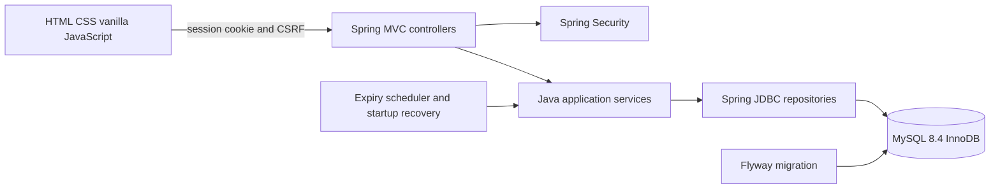
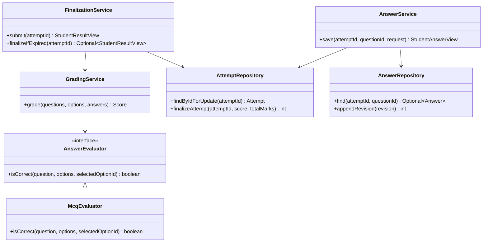

# Architecture

The single Spring Boot process serves the UI and API. Controllers parse validated requests and return role-specific DTOs. `AccessControl` checks the authenticated actor's role and ownership in services; the URL filter alone is not the ownership boundary. Repository classes use parameterized SQL and map immutable domain records. Flyway V1 owns schema creation. `docs/DATABASE.md` contains the complete entity relationship diagram and foreign-key rules.

The OOP boundary is practical: immutable `domain` and `dto` Java records represent stored facts and safe views; service classes encapsulate publication, availability, ownership, revisions, scoring and recovery; `AnswerEvaluator` is an interface implemented by `McqEvaluator` and injected into `GradingService`. The HTTP layer does not calculate a score. Student and instructor question DTOs are separate types, so student serialization has no correctness flag.

## Attempt lifecycle and transaction boundary

1. Starting an open, published exam inserts at most one `(exam_id, student_id)` attempt. A repeat request loads that existing attempt and retains its original deadline.
2. A save begins a transaction, locks the attempt row with `SELECT ... FOR UPDATE`, then rechecks owner, in-progress state, server deadline, question/option relationship and expected revision. Current answer and append-only revision commit together. A clear writes a null selection.
3. Manual submit, lazy expiry, scheduled expiry and startup recovery use the same finalization service and attempt-row lock. The service rechecks deadline/state after locking, evaluates persisted answers against persisted keys, and commits one terminal score. A failed transaction rolls back all grade/answer effects.
4. Aggregate results survive a process restart because attempts, answers, revisions, exams and keys live in MySQL. A closed browser cannot stop the server expiry sweep. The browser countdown is guidance; server time decides acceptance.

Published exams are immutable through authoring services and an exam-row lock. Foreign keys, unique attempt and revision constraints, and service checks jointly guard relationships. The MVP assumes one Java instance. Its active session registry and login-throttle counters are in memory; a restart clears those counters and sessions but not exam data.

## Security and privacy boundaries

Passwords are encoded before persistence. Spring Security rotates the session ID at login, enforces CSRF on mutations, limits students to one active login, uses a 15-minute idle session, and sends safe errors. A Content Security Policy and DOM text rendering protect user-supplied paper text. The instructor who owns an active attempt can reset a lost student session without extending the deadline; that action is recorded in sanitized MySQL security events. Students receive their own aggregate result only, with no answer key, password hash or other student's record.

This is an examination workflow, not a proctoring system: it does not watch cameras, lock down devices, detect off-screen assistance or prove the person at a keyboard. Operators should supervise exams through their own institutional procedures. For public hosting, use HTTPS, secure cookies, protected secrets, monitored backups and a separately authorized deployment target; see [deployment runbook](docs/DEPLOYMENT.md).
