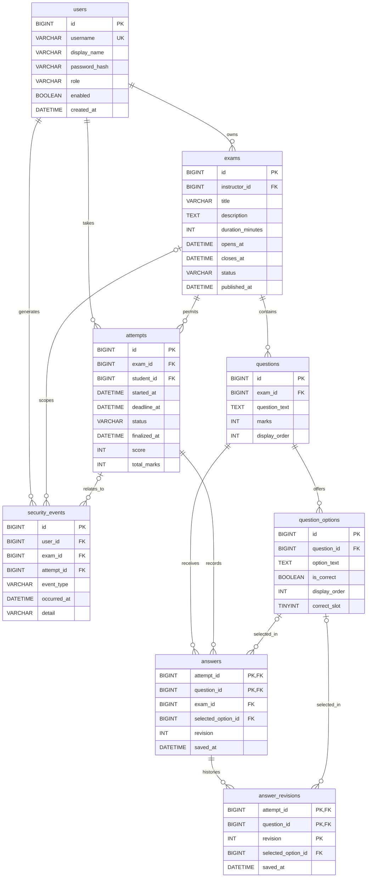

# Database contract

Flyway migration [`V1__exam_schema.sql`](../src/main/resources/db/migration/V1__exam_schema.sql) defines the MySQL 8.4/InnoDB schema. `online_exam` is the persistent local application database. `online_exam_it` and `online_exam_e2e` are disposable test databases. Flyway owns schema changes; application code must not issue `CREATE TABLE` at runtime.

## Key integrity rules

- `users.username` is unique. Only `STUDENT` and `INSTRUCTOR` role values are allowed. Services must check role membership and instructor ownership because a foreign key alone cannot enforce them.
- `exams` validates a positive duration, opening before closing and `DRAFT`/`PUBLISHED` state consistency with `published_at`. Published content and timing must be kept immutable by the authoring service while holding the exam row lock; this is not yet a database trigger.
- A question has positive marks and a unique nonnegative order within its exam. An option has a unique nonnegative order within its question. The generated `correct_slot` unique key allows at most one correct option per question. Publication must check for exactly one, 2 to 6 options per question and a nonempty paper.
- `attempts` has a unique `(exam_id, student_id)` key. Deadline must follow start, and terminal rows must contain finalized time and score/total. Save and finalization services must take the same `SELECT ... FOR UPDATE` lock on the attempt row and enforce the authoritative deadline.
- `answers.exam_id` is deliberately repeated so composite foreign keys enforce that the attempt and question refer to the same exam. Another composite foreign key enforces that a nonnull selected option belongs to that question. A null selected option represents a clear action. `(attempt_id, question_id)` is the primary key; the current revision may be zero.
- `answer_revisions` records accepted changes when the save service appends them in the same transaction as the current answer. Its foreign keys require an answer row and, for a nonnull selection, an option belonging to the same question. History revision numbers must be positive and unique for each answer; services must compare expected/current revisions transactionally.
- `security_events` requires a user. Exam and attempt links are optional; the schema does not require a linked attempt to belong to the linked exam, so the event service must validate that relationship when both are supplied. Event details must be redacted and must not contain passwords, CSRF tokens, session IDs or answer keys.

All operational times use `DATETIME(6)` and are written/read as UTC through a UTC-configured MySQL server and JDBC connection. The database does not decide when an exam expires; an injected Java clock and attempt-row transaction determine that. The scheduler and read/write paths share `FinalizationService`.

## Repository and transaction boundaries

The `domain` package contains immutable records that mirror the stored rows. The `repository` package uses parameterized Spring JDBC queries. Inserts into tables with generated IDs return those IDs; answer and revision inserts return affected-row counts. `JdbcValues` maps Java `Instant` values to UTC `DATETIME(6)` values and back. Repositories perform storage operations; authorization, publication rules, deadlines and grading belong in services.

| Repository | Stored rows and important operations |
|---|---|
| `UserRepository` | Account lookup by ID or username, creation and enabled-state update. |
| `ExamRepository` | Exam creation, owner listing, published listing, update/delete and `findByIdForUpdate`; the service must restrict authoring to drafts. |
| `QuestionRepository`, `QuestionOptionRepository` | Ordered question and option CRUD; callers must first verify the parent exam is an editable draft. |
| `AttemptRepository` | Unique exam/student attempt lookup, overdue scan, terminal result update and `findByIdForUpdate`. |
| `AnswerRepository` | Current answer creation/lookup, conditional revision update and revision-row insertion/lookup. It exposes no history update/delete method; the database has no history immutability trigger. |
| `SecurityEventRepository` | Event insertion and user/exam-scoped reads; redaction and scope checks belong in services. |

An authoring service must start a transaction and call `ExamRepository.findByIdForUpdate` before changing or publishing an exam, its questions or its options. It must recheck ownership and `DRAFT` state after acquiring that lock. A save or finalization service must start a transaction and call `AttemptRepository.findByIdForUpdate` before checking owner, terminal state, deadline or answer revision. The current answer write and its revision row must commit together; the same lock is required for submit and timeout finalization. `AttemptRepository.finalizeAttempt` updates only an `IN_PROGRESS` row, but that conditional update alone does not replace the lock and checks. Repository methods do not establish service-level authorization or immutability. A unique `(exam_id, student_id)` key is the database defense against concurrent duplicate starts; the start service must resolve a duplicate-key race by reading the existing authorized attempt.

## Verification state

V1 was applied from an empty `online_exam_it` schema and validated on a second run. `SchemaIT` checked Flyway history, eight operational tables, required indexes and foreign keys, then exercised invalid marks, duplicate correct options and attempts, foreign answer relationships, revision uniqueness and fixture rollback. `RepositoryIT` exercised CRUD, `FOR UPDATE` reads, revisions, terminal update guard, cascades and rollback against real MySQL (V0010/V0011). Later integration checks exercised publication/edit, start, save, submit and timeout races under their service locks; clean source/schema startup and a separate backup/restore passed V0045. Flyway 11.7.2 still logs a vendor support warning for MySQL 8.4; this release's V1 migration passed, while vendor certification and future migrations remain separate maintenance concerns.
